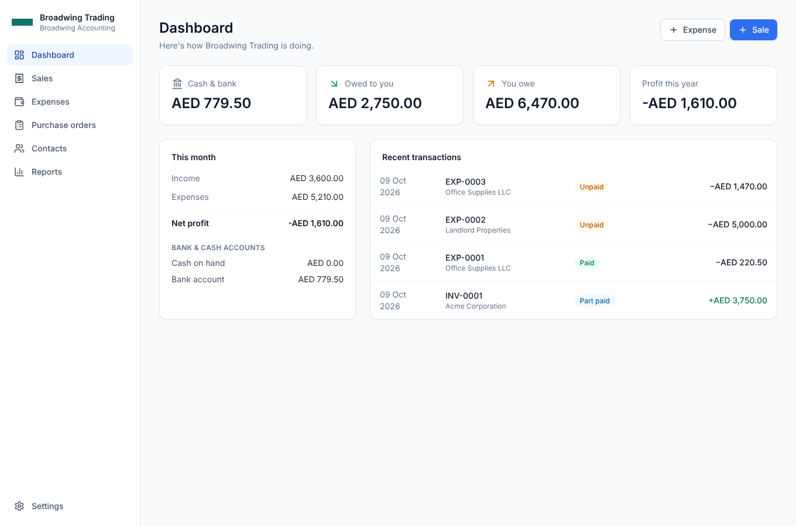

# Broadwing Accounting

Simple, web-based accounting for small businesses, in the spirit of Wave and Xero. It is part of the wider **Broadwing** software suite.

The goal is that anyone can set it up and use it alone, without long configuration. You enter your business details once, and every sale, expense and payment is then posted to a proper double-entry ledger automatically.



## What's in this first draft

| Area | What you can do |
| --- | --- |
| **Setup** | A one-page wizard: business name, currency, address, tax number and an optional VAT/sales-tax rate. It creates a ready-made chart of accounts. |
| **Settings → Business details** | Logo upload, legal name, address, contact details, tax-number label (VAT / GST / TRN…), currency, fiscal year and default payment terms. |
| **Settings → Invoice & PO design** | Template (classic / modern / compact), accent colour, font, logo position and address position, plus titles, default notes, footers and numbering prefixes. Includes a **live preview**. |
| **Settings → Chart of accounts** | Add, edit and archive accounts. Each account type knows its debit/credit side, so you never choose debit or credit yourself. |
| **Settings → Account mapping** | Choose which accounts are used for the automatic entries (receivables, payables, tax, default bank, and so on). |
| **Settings → Taxes** | VAT / sales-tax rates. |
| **Sales** | Invoices (the customer pays later) or cash sales (paid now). Drafts, approval, payments, part payments, void, a branded print/PDF view and attachments. |
| **Expenses** | **One screen for all purchases and expenses**: either *Already paid* (from bank, cash or card) or *Pay later* (a bill). Split across categories, add tax, and **attach a receipt or take a photo with the camera**, at entry time or later. |
| **Purchase orders** | Branded POs to vendors, with **Convert to expense** when the bill arrives. |
| **Contacts** | Customers and vendors. |
| **Reports** | Profit & loss, balance sheet, trial balance and the full journal. |

Every transaction gets a unique number, such as `INV-0001`, `EXP-0001`, `PO-0001` or `PAY-0001`. Each sale and expense also shows the accounting entries behind it.

Users and logins are **intentionally not included**. They will come from Broadwing's central identity service later (see [docs/ARCHITECTURE.md](docs/ARCHITECTURE.md)).

## Tech stack

- **Next.js 15** (App Router, React Server Components, Server Actions) with TypeScript
- **PostgreSQL** with the **Prisma** ORM
- **Tailwind CSS**
- **Vitest** for unit tests of the accounting rules

## Getting started

```bash
# 1. Install dependencies
npm install

# 2. Configure the database connection
cp .env.example .env        # then edit DATABASE_URL

# 3. Create the database tables
npx prisma migrate deploy   # or `npm run db:migrate` during development

# 4. Run the app
npm run dev                 # http://localhost:3000
```

The first time you open the app, it takes you to the setup wizard.

### Useful scripts

| Command | Purpose |
| --- | --- |
| `npm run dev` | Development server |
| `npm run build && npm start` | Production build and server |
| `npm test` | Unit tests (posting rules, totals) |
| `npm run typecheck` | TypeScript check |
| `npm run db:migrate` | Create or apply migrations in development |
| `npm run db:studio` | Browse the database |

## Project layout

```
prisma/schema.prisma          Data model (organization, accounts, sales, expenses, POs, ledger…)
src/lib/accounting/           The accounting engine
  posting.ts                  Pure double-entry rules (sale, expense, payment → journal lines)
  ledger.ts                   Writes and rewrites journal entries in the database
  totals.ts                   Line, tax and total maths (integer cents)
  reports.ts                  P&L, balance sheet, trial balance
  default-chart.ts            Starter chart of accounts
  mapping.ts                  Automatic-entry account mapping keys
src/app/(app)/                Screens: dashboard, sales, expenses, purchase-orders, contacts, reports, settings
src/app/print/                Print / PDF views of invoices and POs
src/app/setup/                First-run setup wizard
src/components/               Shared UI (line-item editor, camera/attachment picker, document renderer…)
```

More detail is in [docs/ARCHITECTURE.md](docs/ARCHITECTURE.md).
